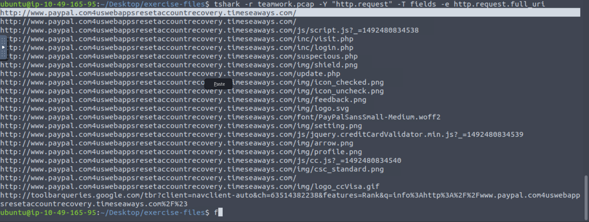
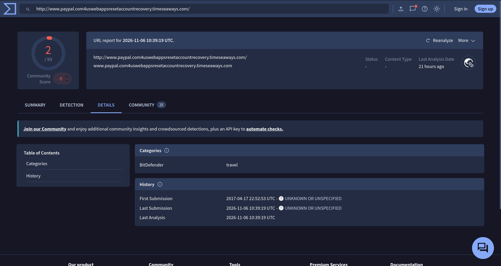
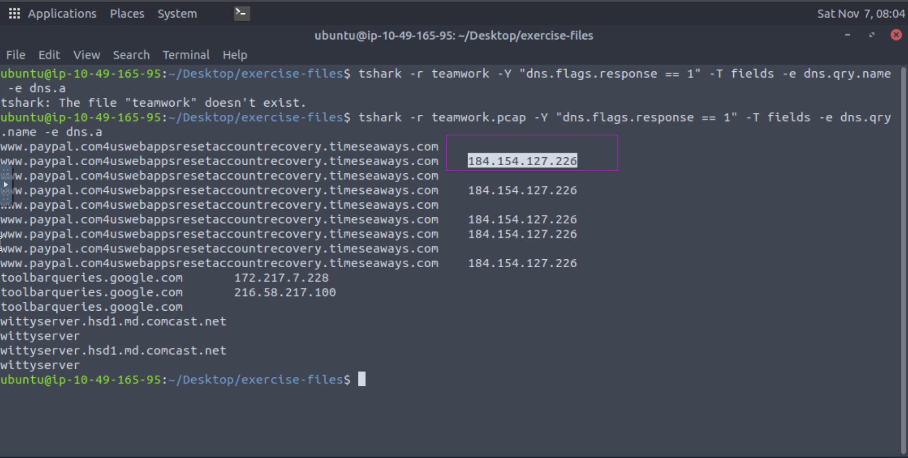
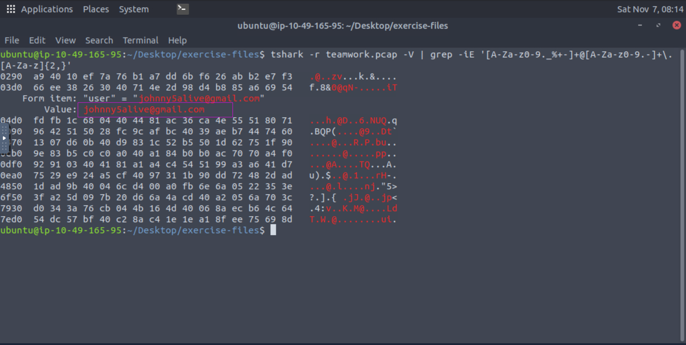

## TShark Challenge I: Teamwork
__An alert has been triggered__: The threat research team discovered a suspicious domain that could be a potential threat to the organisation.  
### Answer the questions below

Q1: Investigate the contacted domains.
Investigate the domains by using VirusTotal.
According to VirusTotal, there is a domain marked as malicious/suspicious.

What is the full URL of the malicious/suspicious domain address?

Enter your answer in defanged format.
```bash
hxxp[://]www[.]paypal[.]com4uswebappsresetaccountrecovery[.]timeseaways[.]com
```
For this we read the file and fitler the the traffic for http and get the full urls requested.We used this command.  
  ``tshark -r capture.pcap -Y "http.request" \
-T fields -e http.request.full_uri``  




From this screenshot we can see that nearly all traffic was going to this url ``tshark -r capture.pcap -Y "http.request" \
-T fields -e http.request.full_uri``(Defanged).We went to the virsu total and community score was only 2 but it was the answer. 

Q2:When was the URL of the malicious/suspicious domain address first submitted to VirusTotal?
```bash
2017-04-17 22:52:53 UTC
```
We copy the url and paste in virus total and go to detail tab.There we can see the first submission.


Q3:Which known service was the domain trying to impersonate?
```bash
Paypal
```
We know paypal is an international company that operate payment system.


Q4:What is the IP address of the malicious domain?

Enter your answer in defanged format.
```bash
184[.]154[.]127[.]226
```
To get the ip address of that malicious domain we can use dns traffic to see the resolution of the domain into the ips.  
We use the this command  ``tshark -r capture.pcap -Y "dns.flags.response == 1" \
-T fields -e dns.qry.name -e dns.a`` 




Q5:What is the email address that was used?

Enter your answer in defanged format. (format: aaa[at]bbb[.]ccc)

```bash
johnny5alive[at]gmail[.]com
```
For this we used this command to extract the an address directly from the packets.
``tshark -r teamwork.pcap -V | grep -iE '[A-Za-z0-9._%+-]+@[A-Za-z0-9.-]+\.[A-Za-z]{2,}'
``

