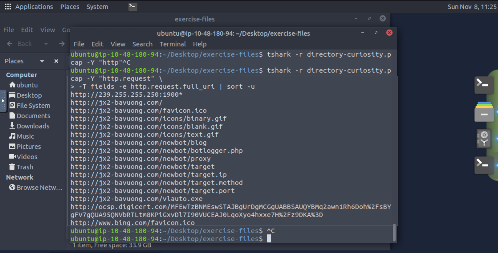
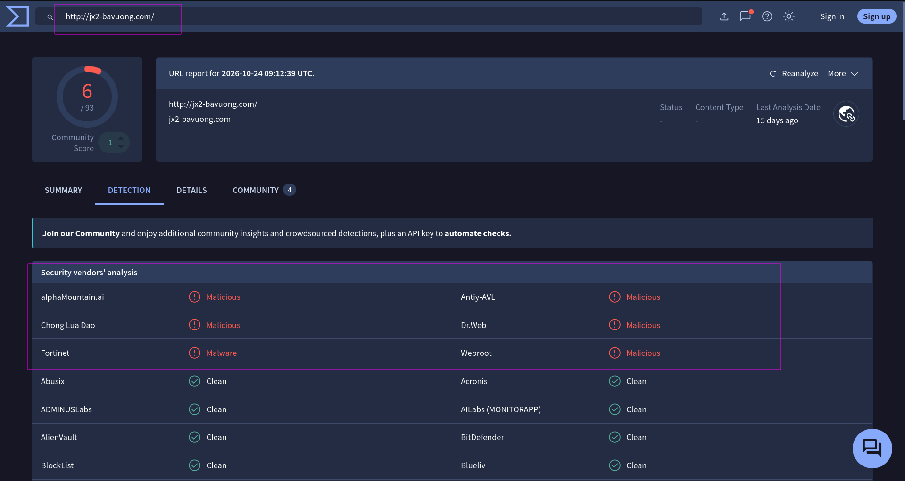
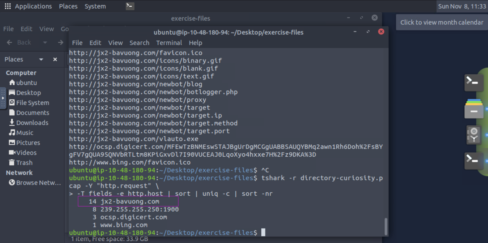
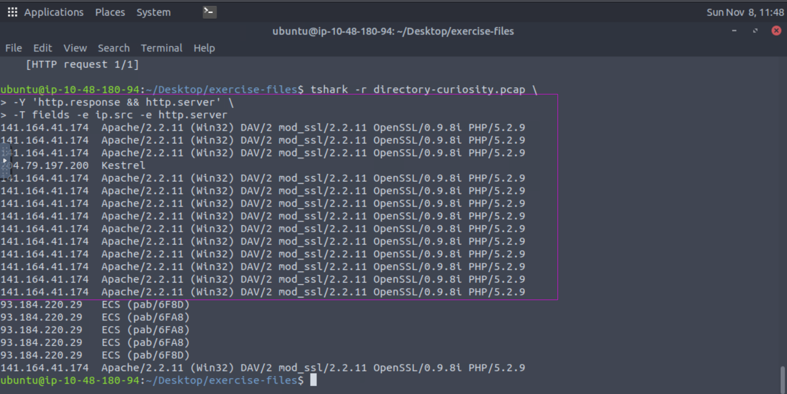
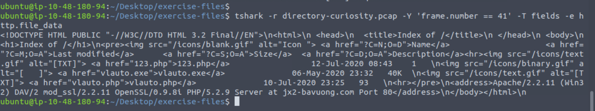
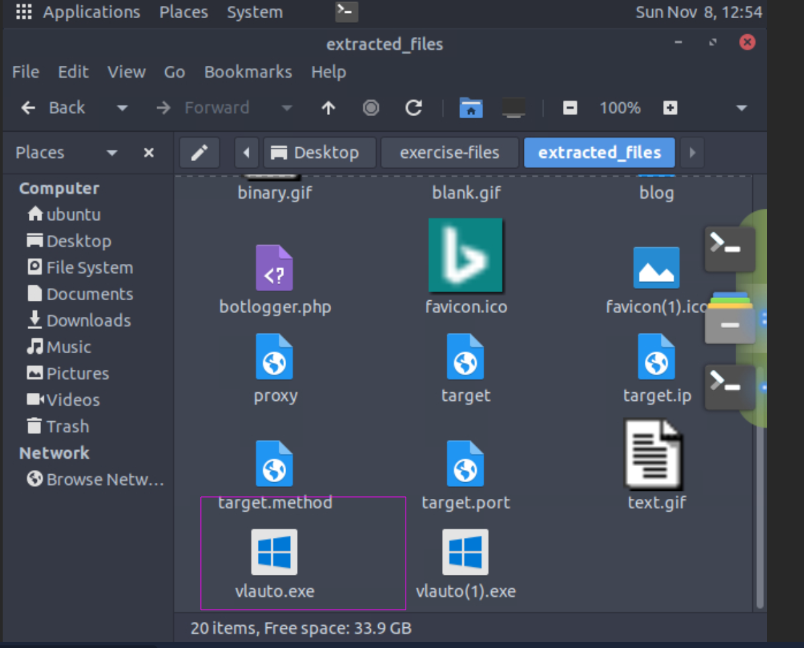
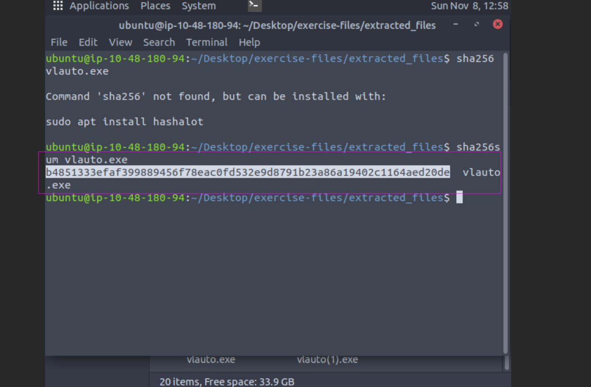
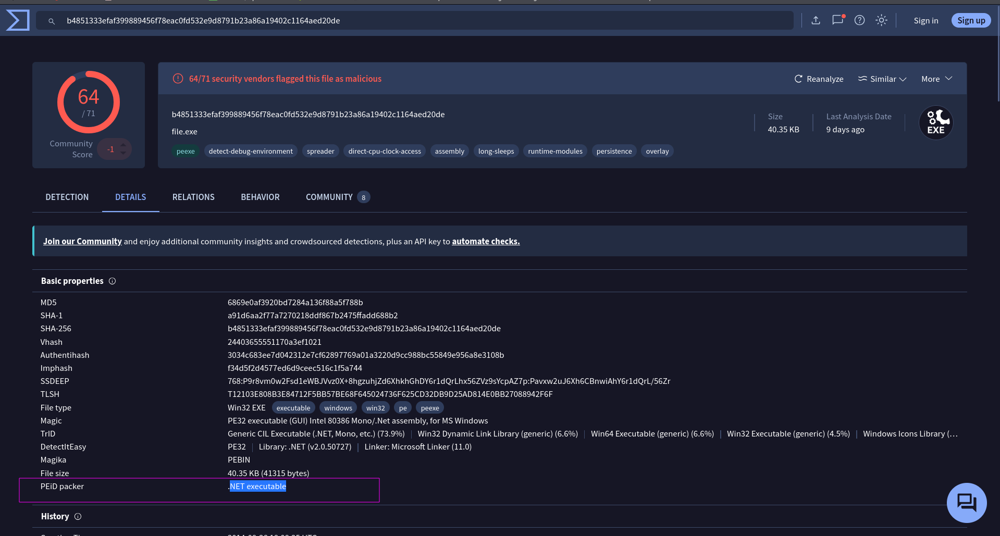
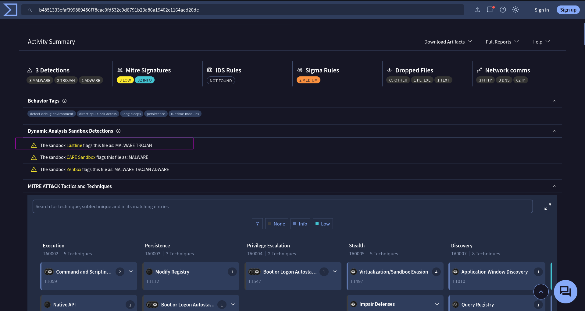

## TShark Challenge II: Directory
An alert has been triggered: __"A user came across a poor file index, and their curiosity led to problems"__.

### Answer the questions below
#### Q1 : Investigate the DNS queries.
Investigate the domains by using VirusTotal.
According to VirusTotal, there is a domain marked as malicious/suspicious.  
What is the name of the malicious/suspicious domain?  
Enter your answer in a defanged format.  
```bash
jx2-bavuong[.]com
```
To find this malicious domain. First We need to finds the domains in the pcap that we find using this command  
 ``tshark -r directory-curiosity.pcap -Y "http.request" \
-T fields -e http.request.full_uri | sort -u`` 


In this image we can see all the urls.But most of them have same domain ``hxxp[://]jx2-bavuong[.]com.`` (defanged) So i copied that domain and paste in Virus total.



we can see in the image it is flagged as malicious.To answer this question only write the domain name no need for protocol.

#### Q2 : What is the total number of HTTP requests sent to the malicious domain?
```bash
14
```
This is quite simple all we have to use flag in tshark for that and we used the following command:  
``tshark -r directory-curiosity.pcap -Y "http.request" \
-T fields -e http.host | sort | uniq -c | sort -nr`` 



#### Q3 : What is the IP address associated with the malicious domain?

Enter your answer in a defanged format.
```bash
141[.]164[.]41[.]174
```
To find the ip associated with the domain we know that dns must be in action at the start of connect to resolve the domain.So we are gonna use this info in the dns packets.We can find the result of dns quries through this tshark command.  
``tshark -r directory-curiosity.pcap \
-Y "dns.flags.response == 1" \
-T fields -e dns.qry.name -e dns.a``

#### Q4:What is the server info of the suspicious domain?
```bash
Apache/2.2.11 (Win32) DAV/2 mod_ssl/2.2.11 OpenSSL/0.9.8i PHP/5.2.9
```
We will use the following command to see the server info of the responses:  
``tshark -r directory-curiosity.pcap \
-Y 'http.response && http.server' \
-T fields -e ip.src -e http.server``

 

As we remeber our malicious domain ip which is ``141[.]164[.]41[.]174`` So we got to know which server is associated with the domain.

#### Q5 : Follow the "first TCP stream" in "ASCII".
#### Investigate the output carefully.
#### What is the number of listed files?
```bash
3
```
First i tried multiple things but it didnt get anything.Then i checked the packets association with the stream for this ip ``141[.]164[.]41[.]174``.So there was two packets with for stream 0 Remeber first stream is 0 not 1.For packet ``24`` we didnt get anything and for packet ``41`` 



There are three file named as: 
* __123.php__
* __vlauto.exe__
* __vlauto.php__

#### Q6 : What is the filename of the first file?
Enter your answer in a defanged format.
```bash
123[.]php
```
From our previous question we got to know the first file is ``123[.]php``

#### Q7:Export all HTTP traffic objects.
What is the name of the downloaded executable file?
Enter your answer in a defanged format.
```bash
vlauto[.]exe
```
Ok for this we need to extract all objects from pcap.We can use the following tshark command for that:  
``tshark -r directory-curiosity.pcap \
--export-objects http,./extracted_files``
Now all objects will be in this directory ``./extracted_files``.Open the directory and we can see the executble file.



#### Q8 : What is the SHA256 value of the malicious file?
```bash
b4851333efaf399889456f78eac0fd532e9d8791b23a86a19402c1164aed20de
```
We need to execute this command where the file is present:  
``sha256sum vlauto.exe``



#### Q9 : Search the SHA256 value of the file on VirtusTotal.
What is the "PEiD packer" value?
```bash
.NET executable
```
Copy the hash value and paste in virus total and go to detail tab.


#### Q10:Search the SHA256 value of the file on VirtusTotal.
What does the "Lastline Sandbox" flag this as?
```bash
MALWARE TROJAN
```

